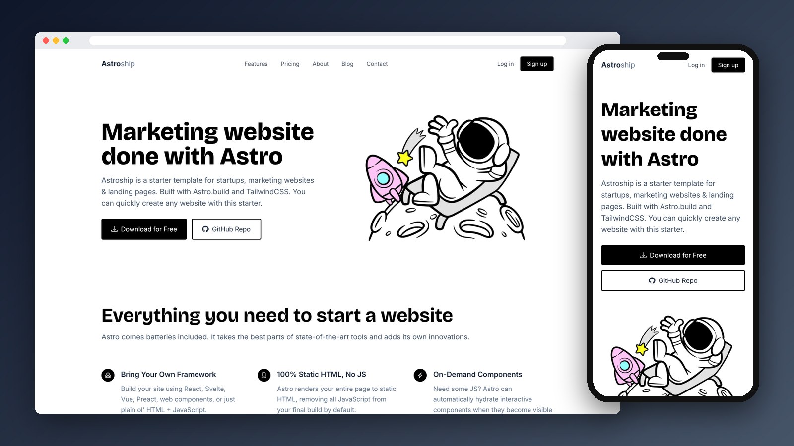

<div align="center">

# Astroship

A clean startup / marketing landing page, built with Tailwind CSS utility classes.

[](https://mo7-adad.github.io/astroship/)

   

</div>

---



## Features

- Hero section with call-to-action buttons and illustration
- Six-card features grid with icons
- "Works with your technologies" logo strip
- Dark call-to-action banner and simple footer
- Mobile-first responsive layout with Tailwind breakpoints

## Project Structure

```
astroship/
├── index.html
└── images/
```

## Run Locally

```bash
git clone https://github.com/mo7-adad/astroship.git
cd astroship
```

Then open `index.html` in your browser, or right-click it in VS Code and choose **Open with Live Server**.

## Author

**Mohamed Elhadad** — Front-End Developer

[](https://github.com/mo7-adad)
